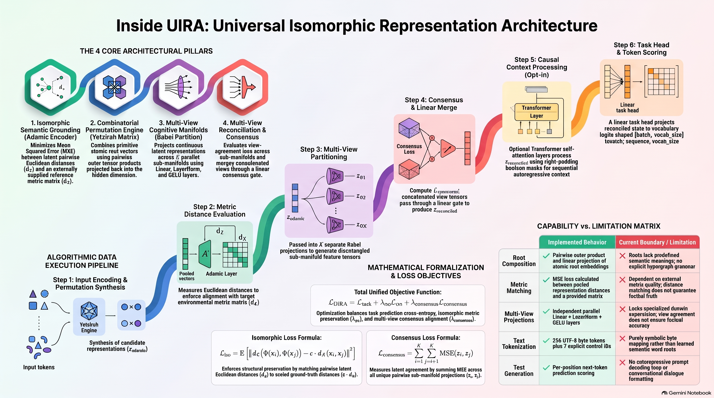
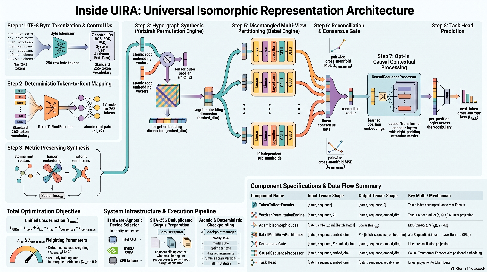
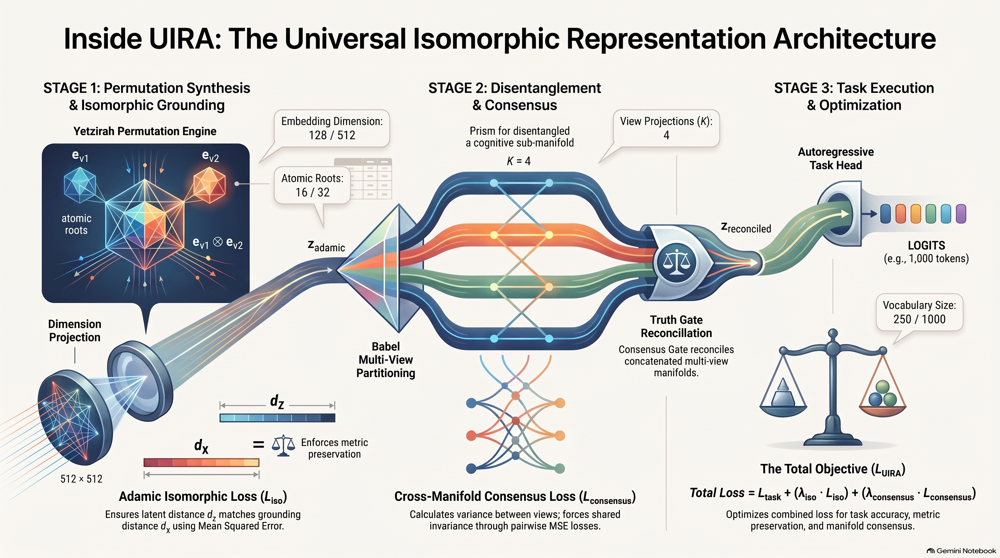
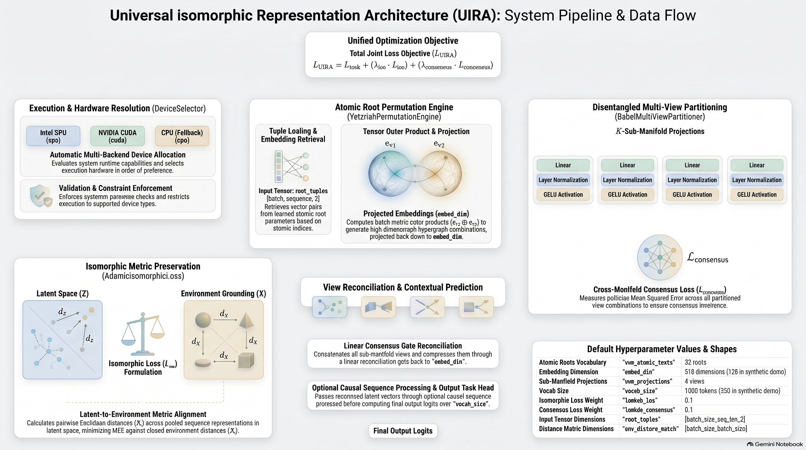
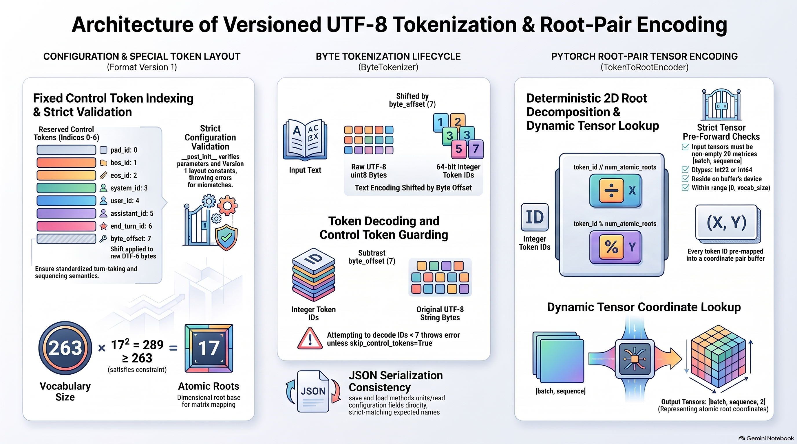
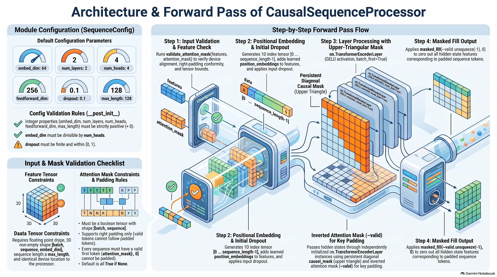
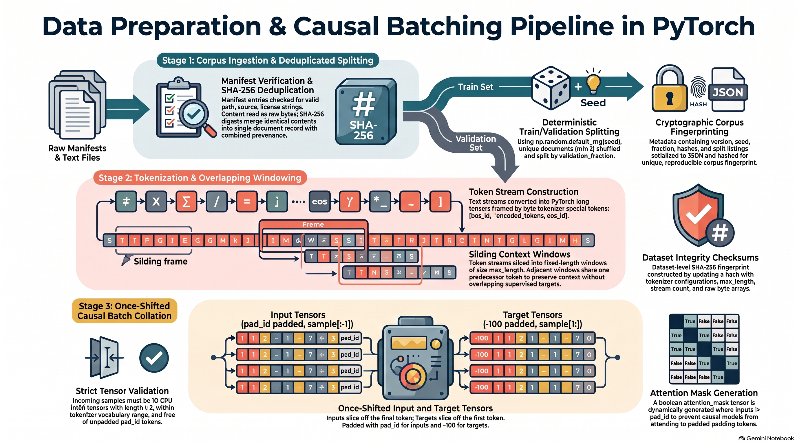
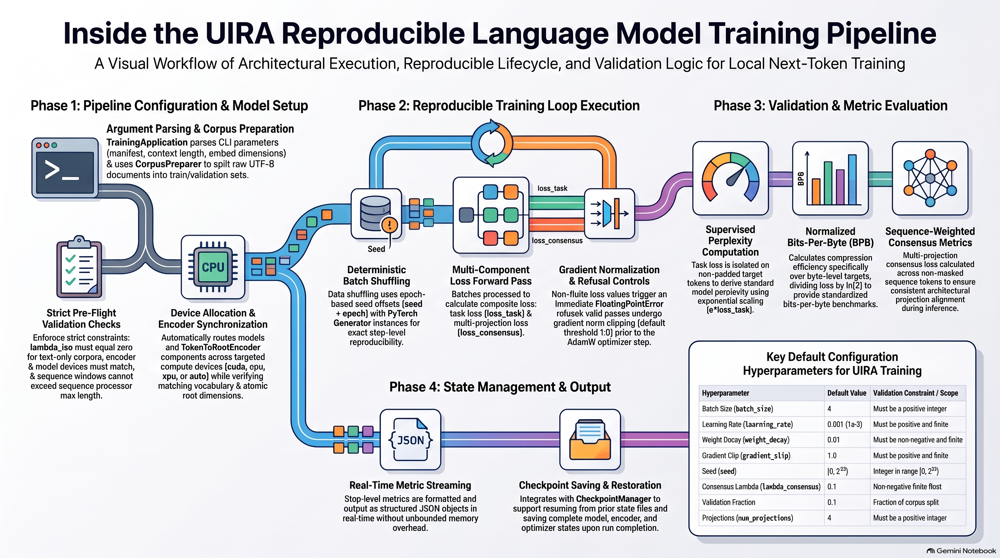
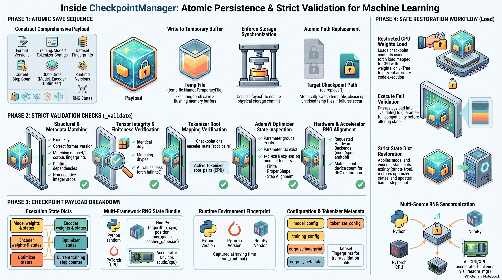

# 📐 Technical Architecture Specification

## 🌌 Universal Isomorphic Representation Architecture (UIRA)

<p align="center">
    
    <a href="LICENSE"></a>
    <a href="#unit-tests"></a>
    <a href="#getting-started"></a>
    <a href="https://pytorch.org/"></a>
    <a href="https://docs.pytorch.org/docs/stable/notes/get_start_xpu.html"></a>
</p>

*A research prototype for tensor-product composition, metric matching, and multi-view representation learning*

<div align="center">

---

| Metadata Field | Specification Details |
| :---: | :---: |
| **Domain** 🏷️ | Representation Learning / Category Theory |
| **Paradigm** ⚙️ | Isomorphic Embedding & Hypergraphs |
| **Status** 🧪 | Runnable synthetic prototype; capabilities not benchmarked |
| **Audio Theme** 🎵 | [Suno AI Track](https://suno.com/s/SJpCZBfVr9DHxJFy?utm_source=gemini) |
| **Architecture** 🔗 | [Current implementation](./docs/architecture.md) |
| **Media** | [Infographics and diagrams](./media/) |

---

</div>

### Reference Architecture Image


This is the original conceptual reference image, not a verified map of implemented
capabilities. See the [architecture documentation](./docs/architecture.md) for
the current components, tensor flow, training pipeline, and limitations.

### Infographic Image Map

Browse the [media folder](./media/) or select a thumbnail below to open the
full-size infographic. These illustrations are reference material; the
[architecture documentation](./docs/architecture.md) describes implemented
behavior and limitations.

| Architecture overview | System architecture | Universal representation |
| :---: | :---: | :---: |
| [](./media/UIRA_Architecture_Diagram_Overview.png) | [](./media/UIRA_Architecture_System_Diagram.png) | [](./media/Universal_Isomorphic_Representation_Architecture.png) |

| System data flow | Tokenization and root encoding | Causal sequence processor |
| :---: | :---: | :---: |
| [](./media/System_Architecture_Data_Flow_Diagram.png) | [](./media/Tokenization_and_Root_Encoding_Architecture.png) | [](./media/CausalSequenceProcessor_Architecture_Forward_Pass.png) |

| Data preparation and batching | Language-model training | Checkpoint management |
| :---: | :---: | :---: |
| [](./media/Data_Preparation_Causal_Batching_Pipeline.png) | [](./media/Language_Model_Training_Pipeline_Diagram.png) | [](./media/Machine_Learning_Checkpoint_Manager_Diagram.png) |

### 📜 Abstract & Theoretical Foundation

UIRA explores three ideas: composing learned root vectors through tensor products, matching latent distances to externally supplied distances, and reconciling multiple learned projections. Its historical naming is inspiration, not evidence for the mathematical or empirical validity of the architecture.

The [PyTorch implementation](./uira.py) is a real trainable neural network, but it is not a pretrained language model or a conversational system comparable to deployed OpenAI models. There is no demonstrated guarantee of grounding, truth verification, hallucination elimination, or superior generalization.

## Current Capabilities and Limitations

| Component | Implemented behavior | Limitation |
| --- | --- | --- |
| Root composition | Learned root embeddings combined by a pairwise outer product and linear projection | Roots have no predefined semantic meaning; no explicit hypergraph grammar is implemented |
| Metric matching | MSE between pairwise distances of pooled representations and a supplied matrix | Meaning depends on the supplied metric; matching distances does not prove an isomorphism or causal understanding |
| Multiple views | Independent Linear/LayerNorm/GELU projections | No explicit temporal, spatial, or logical specialization |
| Reconciliation | Pairwise view-agreement loss and a linear merge | Agreement is not factual verification; views may become redundant |
| Token scores | A linear head outputs `[batch, sequence, vocabulary]` logits | Uses preceding context only when the optional sequence processor is enabled |
| Synthetic training example | One optimizer step with random root pairs, targets, and a symmetric random distance matrix | Not a capability benchmark; the random matrix is not guaranteed to be a valid metric |
| Language training | Local UTF-8 corpus preparation, shifted next-token training, held-out metrics, and versioned checkpoint resume | No pretrained model supplied; bundled toy corpus verifies mechanics, not language quality |
| Text tokenizer / text-to-root encoder | UTF-8 byte tokenizer, versioned configuration, and deterministic root-pair mapping | Mapping is a symbolic code, not learned semantic roots |
| Contextual sequence processing | Opt-in causal Transformer layers, learned positions, and right-padding masks | Small CPU mechanics checks passed; no broad language-quality results |
| Autoregressive text generation | Not implemented | No prompt encoding, decoding loop, or stopping rules |
| Instruction following / conversation training | Not implemented | No conversation format, assistant-only training objective, or dialogue dataset |

The token-scoring head alone is not an autoregressive decoder. Trainable weights and a successful backward pass establish that the computation can be optimized, not that it understands language.

See the [language-model implementation plan](./docs/language_model_plan.md) for phased work on the four missing language capabilities, acceptance criteria, and evidence required before making stronger claims.

The roadmap requires object-oriented Python: focused model, encoding, dataset, trainer, checkpoint, generator, evaluator, and application classes composed through explicit dependencies. The [repository Copilot instructions](./.github/copilot-instructions.md) require this design, unit tests, and reuse of suitable maintained libraries. The synthetic example now lives in `SyntheticTrainingExample`; `select_device` remains a compatibility delegate to `DeviceSelector`.

## Getting Started

The runnable prototype requires Python 3.9 or newer. By default, install the CPU build of PyTorch. From the repository root, create and activate a virtual environment, install the dependencies, and run the example:

```bash
python3 -m venv .venv
source .venv/bin/activate
python -m pip install -r requirements.txt
python uira.py
```

The script automatically selects an available Intel XPU, CUDA device, or CPU in that order. You can select a device explicitly with `python uira.py --device xpu`, `--device cuda`, or `--device cpu`.

For an Intel GPU, install the XPU-enabled PyTorch build instead of the default CPU build:

```bash
python -m pip install -r requirements-xpu.txt
python uira.py --device xpu
```

Intel XPU execution requires a supported Intel GPU and the host Intel GPU driver. See the [official PyTorch Intel GPU prerequisites](https://docs.pytorch.org/docs/stable/notes/get_start_xpu.html#software-prerequisite). GPU access is provided by the host driver; Docker does not replace that driver or expose an unavailable GPU.

For Intel Iris Xe under WSL 2, PyTorch DirectML is an experimental alternative. It requires Windows 11 build 22000 or later and a current Windows GPU driver. The DirectML package is a preview and pins an older PyTorch version, so install it in a separate environment:

```bash
python3 -m venv .venv-directml
.venv-directml/bin/python -m pip install -r requirements-directml.txt
.venv-directml/bin/python -c "import torch, torch_directml; device = torch_directml.device(); value = torch.ones(2, device=device); print(device, value)"
```

The tensor check must succeed before attempting model execution. DirectML is not yet integrated into the example's `--device` options; the current WSL host fails this initial allocation, so GPU execution has not been verified. See Microsoft's [PyTorch DirectML on WSL guide](https://learn.microsoft.com/windows/ai/directml/pytorch-wsl).

The example runs one synthetic training step and prints the selected device, losses, and output shape. The architecture is a research prototype; theoretical goals in this document are not claims of verified production behavior.

### Text Encoding (Phase 1)

[text_encoding.py](./text_encoding.py) provides 256 UTF-8 byte tokens and seven
explicit control IDs. NumPy handles CPU byte preprocessing; a registered PyTorch
buffer maps the 263 IDs to unique pairs of 17 roots on the selected device.
The mapping does not assign semantic meanings to roots.

```python
import torch
from text_encoding import ByteTokenizer, TokenToRootEncoder

tokenizer = ByteTokenizer()
token_ids = tokenizer.encode("Hello, UIRA!")
assert tokenizer.decode(token_ids) == "Hello, UIRA!"
encoder = TokenToRootEncoder(tokenizer.config)
root_pairs = encoder(torch.tensor([token_ids], dtype=torch.long))
tokenizer.save("tokenizer.json")
restored = ByteTokenizer.load("tokenizer.json")
assert restored.config == tokenizer.config
```

Text-configured models must use `num_atomic_roots=tokenizer.config.num_atomic_roots`
and `vocab_size=tokenizer.config.vocab_size`, not the synthetic example's 16/250
settings. Control tokens must be inserted by ID, not recognized from user text.
Decoding is strict UTF-8; control IDs require explicit `skip_control_tokens=True`.
Contextual processing and local language training are available as described
below; a generation loop is not implemented yet.

### Causal Context (Phase 2)

[sequence_model.py](./sequence_model.py) provides configurable PyTorch causal
self-attention after reconciliation and before token scoring. It is disabled
by default, preserving the existing synthetic example and legacy model weights.

```python
from sequence_model import SequenceConfig
from uira import UIRAFullArchitecture

model = UIRAFullArchitecture(
    num_atomic_roots=tokenizer.config.num_atomic_roots,
    vocab_size=tokenizer.config.vocab_size,
    embed_dim=64,
    sequence_config=SequenceConfig(embed_dim=64),
)
attention_mask = torch.ones(root_pairs.shape[:2], dtype=torch.bool)
outputs = model(root_pairs, attention_mask=attention_mask)
assert outputs["logits"].shape == (1, len(token_ids), 263)
```

The snippet continues the Phase 1 example. Boolean masks use True for valid
tokens and False for right-padding; omitting a mask treats all positions as
valid. Metric pooling, view agreement, and task loss ignore padding. Contextual
states at padding positions are zero, but padded logits must still be ignored.
Each sequence must have a valid first token. Empty, all-padding, overlength,
and left/interior-padded sequences are rejected explicitly. Token/root IDs,
masks, and model parameters must be on the same device.

For task loss, callers supply `[batch, sequence]` int64 targets already shifted
for next-token prediction; `-100` means ignore. The training pipeline below
prepares these labels; the tensor interface does not generate text.

### Next-Token Training and Checkpoints (Phase 3)

[train.py](./train.py) trains on local documents using PyTorch datasets,
DataLoader, AdamW, and gradient clipping. [training_data.py](./training_data.py)
deduplicates exact document bytes before a seeded train/validation split, then
creates windows with one shared predecessor and no repeated supervised targets.
BOS/EOS are inserted once per document, not at arbitrary window boundaries.

Run a small CPU experiment with the original CC0 toy fixtures:

```bash
python train.py \
  --manifest examples/toy_corpus/manifest.jsonl \
  --output checkpoints/toy.pt \
  --device cpu --steps 20 \
  --embed-dim 16 --heads 2 --layers 1 --feedforward-dim 32 \
  --context-length 32 --dropout 0
```

Repeat the same command with `--resume checkpoints/toy.pt` to run **20 additional
steps**. Use `python train.py --help` for batch size, learning rate, clipping,
weight decay, seed, validation fraction, and model options. The full default
text configuration uses width 64, two layers, and context length 128.

For your own data, supply a UTF-8 JSONL manifest with exactly these fields:

```json
{"path": "documents/example.txt", "source": "your source URL or dataset identifier", "license": "your applicable license"}
```

Paths are relative to the manifest (absolute paths also work). Supply at least
two unique documents so that both splits are nonempty. Source and license
fields are required; you are responsible for verifying permission to train on
the content. This is an in-memory research pipeline, not a streaming web-scale
loader. Exact deduplication does not detect near-duplicates or semantic leakage.

Each step prints JSON metrics for task and auxiliary losses. Validation reports
token-weighted task cross-entropy, perplexity including EOS, byte-target-only
perplexity, and bits per byte computed only on byte targets. Auxiliary losses
are separate; no environmental metric is fabricated for text (`lambda_iso=0`).
Different tokenizations do not have directly comparable perplexities.

[checkpoints.py](./checkpoints.py) atomically saves model/encoder/AdamW state,
tokenizer/root and architecture configuration, document provenance/hashes,
corpus/split/window fingerprints, step/data position, and Python/NumPy/PyTorch
RNG states. Resume requires matching configurations, datasets, device type,
and runtime library versions; it restores data order and dropout RNG state.
CPU exact continuation is tested. Matching accelerator execution and numerical
determinism remain unverified without hardware. Only load trusted checkpoints,
even though restricted `weights_only=True` loading is used. Checkpoints and
downloaded datasets are excluded from source control.

No pretrained weights or useful conversation capability are implied. The toy
corpus and tiny-corpus overfit check validate the pipeline, not generalization.

### Unit Tests

After installing the runtime requirements in the active virtual environment:

```bash
python -m pip install -r requirements-dev.txt
python -m pytest
```

The Phase 1-3 suite covers Unicode round trips, configuration validation/persistence,
all token-to-root mappings, invalid inputs, legacy objective equivalence,
device selection, dtype propagation, model gradients, causal isolation,
prefix-dependent learning, masked losses, contextual state reload, document
splits/windowing, training, token-weighted metrics, checkpoint corruption,
exact CPU resume, and the training CLI. Accelerator checks
are skipped explicitly when hardware is unavailable. NumPy is included in each
runtime requirements variant; the experimental older DirectML stack uses NumPy
below 2 for compatibility.

---

## 1. 🏗️ Architectural Pipeline Overview

The following is the research formulation, not a claim of verified cognitive capabilities. The implemented order is root composition, optional distance loss on pooled compositions, learned projections, linear reconciliation, optional causal contextual processing, and token scoring.

1. **🎯 Isomorphic Grounding Layer (Adamic Encoder)**

$$\Phi : X \longrightarrow Z \quad (\text{Target: } d_X \approx d_Z)$$

2. **🧩 Combinatorial Permutation Engine (Yetzirah Matrix)**

$$H = \sum \left( e_{v_1} \otimes e_{v_2} \otimes \dots \otimes e_{v_k} \right) W \quad (\text{Atomic Hypergraph Permutations})$$

3. **🌐 Multi-View Cognitive Manifolds (Babel Partition)**

$$\pi_1(Z), \pi_2(Z), \dots, \pi_K(Z) \quad (\text{Learned projections; specialization unverified})$$

4. **⚖️ Multi-View Reconciliation (Historically Called the "Truth Gate")**

$$\mathcal{L}_{\text{UIRA}} = \mathcal{L}_{\text{task}} + \lambda_{\text{iso}} \mathcal{L}_{\text{iso}} + \lambda_{\text{consensus}} \mathcal{L}_{\text{consensus}}$$

This is the implemented objective. There is no separate permutation loss or autoregressive training pipeline.

---

## 2. 🧮 Mathematical Formalization of Core Pillars

### 2.1 🎯 Isomorphic Semantic Grounding (The Adamic Encoder)

The Adamic loss penalizes differences between latent Euclidean distances and an externally supplied reference matrix. It does not construct an environmental metric or establish that the supplied relationships are physical, causal, or semantically valid.

For any two state vectors $x_i, x_j \in X$ and their encoder mapping $\Phi(x): X \to Z$:

$$d_Z(\Phi(x_i), \Phi(x_j)) \approx c \cdot d_X(x_i, x_j)$$

$$\mathcal{L}_{\text{iso}} = \mathbb{E}_{x_i, x_j \sim X} \left[ \left\vert{} d_Z(\Phi(x_i), \Phi(x_j)) - c \cdot d_X(x_i, x_j) \right\vert{}^2 \right]$$

> **Research hypothesis:** A meaningful reference metric may improve held-out structural generalization. This requires comparison with baselines; low training loss alone is insufficient.

### 2.2 🧩 Combinatorial Permutation Engine (The Yetzirah Matrix)

The implementation retrieves two learned root vectors, forms their outer product, and projects it back to the embedding dimension. An explicit atomic directed multigraph and grammar are proposed extensions, not implemented structures.

Given $n$ atomic root embeddings $\{e_{v_1}, e_{v_2}, \dots, e_{v_n}\}$ combined under structural operator $\otimes$:

$$h_{\text{concept}} = \sum_{m \in M} \left( \bigotimes_{k=1}^n e_{v_k} \right) W_m$$

In this proposed generalization, $M$ would represent combinations allowed by a formal grammar. The current code implements a single pairwise composition, not this full grammar.

> **Research hypothesis:** Root composition may help generalize to unseen combinations. No zero-shot compositional benchmark is included. The current forward pass supports pairs despite exposing a combination-size constructor option.

### 2.3 🌐 Multi-View Cognitive Partitioning (The Babel Projections)

The latent representation is passed through $K$ separately parameterized projections. Describing them as temporal, spatial, causal, or logical is an intended interpretation, not an implemented assignment or measured property.

For latent representation $z \in Z$, we define sub-manifold projections $\pi_k$:

$$z_k = \pi_k(z) = \text{LayerNorm}(W_k z + b_k) \quad \text{for } k \in \{1, 2, \dots, K\}$$

The equation is schematic; the implementation also applies GELU after LayerNorm. All views use the same architecture, without distinct domain-specific supervision.

> **Research hypothesis:** Multiple views may improve representations. Agreement regularization may also reduce view diversity; both effects need measurement.

### 2.4 ⚖️ Multi-View Agreement and Reconciliation

The implementation sums mean-squared differences between view tensors, concatenates those tensors, and applies a learned linear layer. It does not evaluate propositions, invoke a logical prover, consult evidence, or reject false statements:

$$\mathcal{L}_{\text{consensus}} = \sum_{i=1}^K \sum_{j=i+1}^K \mathrm{MSE}(z_i, z_j)$$

The current total objective is:

$$\mathcal{L}_{\text{UIRA}} = \mathcal{L}_{\text{task}} + \lambda_{\text{iso}} \mathcal{L}_{\text{iso}} + \lambda_{\text{consensus}} \mathcal{L}_{\text{consensus}}$$

> **Limitation:** Agreement is not truth. These losses do not establish factual accuracy or eliminate hallucinations.

---

## 3. 💻 Algorithmic Execution Pipeline

The excerpt below illustrates the original synthetic prototype. Use [uira.py](./uira.py) as the executable source of truth, including its current device-selection CLI. The head produces token scores, not contextual or autoregressive text generation.

```python
import torch
import torch.nn as nn
import torch.nn.functional as F


class AdamicIsomorphicLoss(nn.Module):
    """Enforces metric preservation between environment distance d_X and latent distance d_Z."""

    def __init__(self, c_scale: float = 1.0):
        super().__init__()
        self.c_scale = c_scale

    def forward(
        self, z_representations: torch.Tensor, d_x_grounding: torch.Tensor
    ) -> torch.Tensor:
        # Compute pairwise Euclidean distances in latent space Z -> d_Z(Phi(x_i), Phi(x_j))
        d_z = torch.cdist(z_representations, z_representations, p=2)

        # L_iso = E [ | d_Z - c * d_X |^2 ]
        loss_iso = F.mse_loss(d_z, self.c_scale * d_x_grounding)
        return loss_iso


class YetzirahPermutationEngine(nn.Module):
    """Compiles representations via tensor-product combinations of atomic root embeddings."""

    def __init__(
        self,
        num_atomic_roots: int = 32,
        embed_dim: int = 512,
        root_combination_size: int = 2,
    ):
        super().__init__()
        self.embed_dim = embed_dim
        self.root_combination_size = root_combination_size
        self.atomic_roots = nn.Parameter(
            torch.randn(num_atomic_roots, embed_dim)
        )

        # Project tensor products back down to hidden dimension
        self.permutation_projection = nn.Linear(
            embed_dim**root_combination_size, embed_dim
        )

    def forward(self, root_tuples: torch.Tensor) -> torch.Tensor:
        # root_tuples shape: [batch_size, seq_len, root_combination_size]
        batch_size, seq_len, k = root_tuples.shape

        # Retrieve root vectors: [batch_size, seq_len, k, embed_dim]
        selected_roots = self.atomic_roots[root_tuples]

        # Calculate Tensor Outer Product across the k root dimensions
        # For k=2: e_v1 (tensor_prod) e_v2 -> shape [batch, seq, embed_dim * embed_dim]
        r1 = selected_roots[:, :, 0, :]
        r2 = selected_roots[:, :, 1, :]
        tensor_prod = torch.bmm(
            r1.view(-1, self.embed_dim, 1), r2.view(-1, 1, self.embed_dim)
        ).view(batch_size, seq_len, -1)

        # Project hypergraph permutation back to standard latent dimension
        h_concept = self.permutation_projection(tensor_prod)
        return h_concept


class BabelMultiViewPartitioner(nn.Module):
    """Projects continuous latent space into K disentangled cognitive sub-manifolds."""

    def __init__(self, embed_dim: int = 512, num_projections: int = 4):
        super().__init__()
        self.num_projections = num_projections
        self.projections = nn.ModuleList([
            nn.Sequential(
                nn.Linear(embed_dim, embed_dim),
                nn.LayerNorm(embed_dim),
                nn.GELU(),
            )
            for _ in range(num_projections)
        ])

    def forward(self, z: torch.Tensor) -> list[torch.Tensor]:
        return [proj(z) for proj in self.projections]


class UIRAFullArchitecture(nn.Module):
    """Complete Universal Isomorphic Representation Architecture (UIRA)."""

    def __init__(
        self,
        num_atomic_roots: int = 32,
        embed_dim: int = 512,
        num_projections: int = 4,
        vocab_size: int = 1000,
        lambda_iso: float = 0.1,
        lambda_consensus: float = 0.1,
    ):
        super().__init__()
        self.lambda_iso = lambda_iso
        self.lambda_consensus = lambda_consensus

        # Core Components
        self.yetzirah_engine = YetzirahPermutationEngine(
            num_atomic_roots, embed_dim
        )
        self.isomorphic_loss_fn = AdamicIsomorphicLoss(c_scale=1.0)
        self.babel_partitioner = BabelMultiViewPartitioner(
            embed_dim, num_projections
        )

        # Reconciliation Gate
        self.consensus_gate = nn.Linear(
            embed_dim * num_projections, embed_dim
        )

        # Per-position token-scoring head; no contextual decoder
        self.task_head = nn.Linear(embed_dim, vocab_size)

    def forward(
        self,
        root_tuples: torch.Tensor,
        env_distance_matrix: torch.Tensor = None,
        target_tokens: torch.Tensor = None,
    ) -> dict[str, torch.Tensor]:

        # 1. Permutation Synthesis (Yetzirah Engine)
        z_adamic = self.yetzirah_engine(root_tuples)  # [batch, seq, embed_dim]

        # 2. Compute Isomorphic Metric Loss (Adamic Layer)
        loss_iso = torch.tensor(0.0, device=z_adamic.device)
        if env_distance_matrix is not None:
            # Flatten spatial dims to evaluate pairwise distance on pooled sequence vectors
            z_pooled = z_adamic.mean(dim=1)
            loss_iso = self.isomorphic_loss_fn(z_pooled, env_distance_matrix)

        # 3. Disentangled Sub-Manifold Projections (Babel Partition)
        views = self.babel_partitioner(
            z_adamic
        )  # K tensors of shape [batch, seq, embed_dim]

        # 4. Cross-Manifold Consensus Invariance Loss
        loss_consensus = torch.tensor(0.0, device=z_adamic.device)
        num_views = len(views)
        for i in range(num_views):
            for j in range(i + 1, num_views):
                loss_consensus += F.mse_loss(views[i], views[j])

        # 5. Linear Multi-View Reconciliation
        concat_views = torch.cat(views, dim=-1)
        z_reconciled = self.consensus_gate(concat_views)

        # 6. Per-Position Task Prediction & Cross-Entropy
        logits = self.task_head(z_reconciled)
        loss_task = torch.tensor(0.0, device=z_adamic.device)
        if target_tokens is not None:
            loss_task = F.cross_entropy(
                logits.view(-1, logits.size(-1)), target_tokens.view(-1)
            )

        # Total Objective Function: L_UIRA = L_task + λ1 * L_iso + λ2 * L_consensus
        total_loss = (
            loss_task
            + (self.lambda_iso * loss_iso)
            + (self.lambda_consensus * loss_consensus)
        )

        return {
            "logits": logits,
            "z_final": z_reconciled,
            "total_loss": total_loss,
            "loss_task": loss_task,
            "loss_iso": loss_iso,
            "loss_consensus": loss_consensus,
        }


# ==========================================
# Functional Execution Script / Verification
# ==========================================
if __name__ == "__main__":
    # Hyperparameters
    BATCH_SIZE = 4
    SEQ_LEN = 8
    EMBED_DIM = 128
    NUM_ROOTS = 16
    VOCAB_SIZE = 250

    # Initialize Model & Optimizer
    model = UIRAFullArchitecture(
        num_atomic_roots=NUM_ROOTS,
        embed_dim=EMBED_DIM,
        num_projections=4,
        vocab_size=VOCAB_SIZE,
    )
    optimizer = torch.optim.AdamW(model.parameters(), lr=1e-3)

    # Mock Input Data:
    # 1. Root Tuples (2 primitive roots per token position)
    mock_root_tuples = torch.randint(0, NUM_ROOTS, (BATCH_SIZE, SEQ_LEN, 2))

    # 2. Environment Metric Matrix d_X (Pairwise physical/relational distances)
    mock_env_distance = torch.rand(BATCH_SIZE, BATCH_SIZE)
    mock_env_distance = (
        mock_env_distance + mock_env_distance.T
    ) / 2.0  # Symmetric distance

    # 3. Target Token IDs for training
    mock_targets = torch.randint(0, VOCAB_SIZE, (BATCH_SIZE, SEQ_LEN))

    # Single Training Step Simulation
    optimizer.zero_grad()

    outputs = model(
        root_tuples=mock_root_tuples,
        env_distance_matrix=mock_env_distance,
        target_tokens=mock_targets,
    )

    # Backpropagate total loss
    outputs["total_loss"].backward()
    optimizer.step()

    # Diagnostics Output
    print("--- UIRA Pipeline Execution Successful ---")
    print(f"Total Loss:        {outputs['total_loss'].item():.4f}")
    print(f"  ├─ Task Loss:      {outputs['loss_task'].item():.4f}")
    print(f"  ├─ Iso Loss:       {outputs['loss_iso'].item():.4f}")
    print(f"  └─ Consensus Loss: {outputs['loss_consensus'].item():.4f}")
    print(f"Output Logits Shape: {outputs['logits'].shape}")

```

---

## 4. 📊 Research Questions and Evidence Needed

| Research question | Current mechanism | Evidence needed |
| --- | --- | --- |
| Does metric matching improve structural generalization? | Distance MSE against supplied relationships | Held-out distortion and downstream performance against a no-metric-loss baseline |
| Does root composition improve unseen combinations? | Pairwise tensor products | Composition-held-out split and a parameter/compute-accounted embedding baseline |
| Do multiple views help? | Learned projections plus agreement loss | Single-view and no-agreement ablations; view-diversity measurements |
| Can UIRA learn contextual language behavior? | Causal stack and small prefix-learning mechanics check | Real training data, held-out next-token evaluation, and generation |

No comparative advantage over Transformers or deployed language models has been established.
