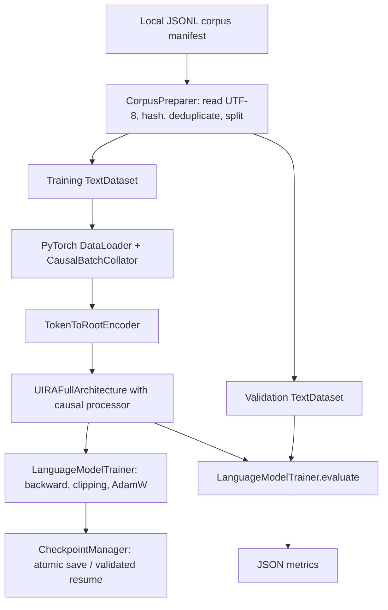
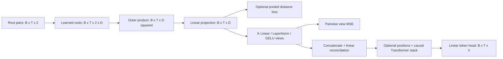

# UIRA Architecture

Status: alpha-v0.0.0.1, implementation through language-model roadmap Phase 3.

UIRA is a PyTorch research prototype combining pairwise root composition,
distance matching, multi-view agreement, and optional causal contextual
processing. It can train a small next-token model on local text and resume
training from checkpoints. It is not a supplied pretrained assistant, factual
verification system, or demonstrated alternative to deployed foundation models.

See the [README](../README.md) for setup and runnable commands, and the
[implementation plan](./language_model_plan.md) for progress and future phases.
The original reference image in the README illustrates the research concept;
the diagrams and interfaces below describe the implemented software.

## 1. System Boundaries

The project has two execution paths:

- **Synthetic example:** `python uira.py` runs one random-data optimization step.
  Contextual processing is disabled, preserving the original per-position model.
- **Text training:** `python train.py ...` prepares local documents, constructs
  an explicitly contextual model, optimizes next-token loss, evaluates a held-out
  split, and saves a checkpoint.

All computation is local. The model does not make network calls. No Katzilla
integration, retrieval engine, BM25 index, generation loop, or conversation
training pipeline is implemented.



## 2. Modules and Ownership

| Module | Classes | Responsibility |
| --- | --- | --- |
| [text_encoding.py](../text_encoding.py) | `TokenizerConfig`, `ByteTokenizer`, `TokenToRootEncoder` | Versioned byte vocabulary, exact text encoding/decoding, registered root lookup |
| [uira.py](../uira.py) | `YetzirahPermutationEngine`, `AdamicIsomorphicLoss`, `BabelMultiViewPartitioner`, `UIRAFullArchitecture` | Root composition, auxiliary objectives, reconciliation, optional contextual stack, token head |
| [uira.py](../uira.py) | `DeviceSelector`, `SyntheticTrainingExample` | Device policy and synthetic example orchestration; `select_device` remains a compatibility delegate |
| [sequence_model.py](../sequence_model.py) | `SequenceConfig`, `CausalSequenceProcessor` | Learned positions and configurable causal self-attention layers |
| [training_data.py](../training_data.py) | `DocumentSource`, `Document`, `PreparedCorpus`, `CorpusPreparer` | Source/license metadata, content hashes, exact deduplication, reproducible document splits |
| [training_data.py](../training_data.py) | `TextDataset`, `CausalBatchCollator` | Token streams, context windows, once-shifted labels, right-padding |
| [train.py](../train.py) | `TrainingConfig`, `LanguageModelTrainer`, `TrainingApplication` | Seeded construction, optimization, evaluation, streaming metrics, CLI |
| [checkpoints.py](../checkpoints.py) | `CheckpointManager` | Versioned model/training artifacts, compatibility checks, RNG restoration |

Components use composition and registered PyTorch modules/parameters/buffers.
Training loops and data loading remain outside model `forward` methods.
Application entry points delegate to workflow classes. Python source/test files
must remain below 600 total lines under the [project instructions](../.github/copilot-instructions.md).

## 3. Text Encoding

`ByteTokenizer` uses UTF-8 rather than a learned subword vocabulary. NumPy
vectorizes CPU byte conversion; PyTorch owns model and device tensor operations.

| IDs | Meaning |
| --- | --- |
| 0 | PAD |
| 1 | BOS |
| 2 | EOS |
| 3, 4, 5 | SYSTEM, USER, ASSISTANT |
| 6 | END_TURN |
| 7-262 | The 256 byte values, offset by 7 |

Role tokens are reserved for future conversation work. Ordinary text is encoded
as bytes even if it spells a role marker. Decoding is strict UTF-8; skipping
control IDs requires an explicit option. Tokenizer JSON persists the format
version, ID allocation, vocabulary size, and root count.

`TokenToRootEncoder` maps token ID `t` to `(t // R, t % R)`, with 17 roots by
default. There are 289 possible pairs for the 263 token IDs. The lookup is a
registered integer buffer, moves with `.to(device)`, and is stored in the
encoder state dictionary. This injective coding does not give the roots
predefined semantic meanings.

## 4. Tensor Pipeline

Notation: `B` batch size, `T` sequence length, `D` embedding width, `K` views,
`V` vocabulary size, and `R` atomic root count.



1. **Root composition:** `YetzirahPermutationEngine` retrieves two vectors from
   a learned `[R, D]` parameter, forms an outer product, and projects its
   flattened `D**2` features to `D`. Only pairs are supported; other combination
   sizes are rejected.
2. **Metric branch:** when a `[B, B]` environment matrix is supplied, the model
   pools valid sequence positions, computes Euclidean distances with
   `torch.cdist`, and penalizes their mismatch with the reference matrix.
3. **Views:** `BabelMultiViewPartitioner` produces `K` independently
   parameterized `[B, T, D]` projections. Agreement loss sums MSE over each
   pair of views, excluding padding in contextual mode.
4. **Reconciliation:** concatenate views to `[B, T, K*D]`, then linearly map
   back to `[B, T, D]`. This is not a truth checker.
5. **Optional context:** add learned positional embeddings and apply dropout
   plus independently initialized PyTorch `TransformerEncoderLayer` modules
   with causal and key-padding masks. Despite the class name, causal masking
   makes this a decoder-only self-attention stack without cross-attention.
6. **Head:** produce `[B, T, V]` logits. With context disabled, predictions
   depend only on the root pair at the same position. With context enabled,
   predictions can depend on the current and preceding valid positions.

`UIRAFullArchitecture` returns `logits`, `z_final`, `total_loss`, `loss_task`,
`loss_iso`, and `loss_consensus`. `z_final` is the representation after optional
contextual processing. Padded contextual states are zero, but head bias can
produce nonzero padded logits; callers must ignore those positions.

### Configuration and Compatibility

Pass `sequence_config=SequenceConfig(...)` to enable context; its width must
match the model's `embed_dim`. Omitting it preserves the legacy architecture
and adds no contextual parameters to its state dictionary.

The text-training defaults are width 64, two layers, four heads, feed-forward
width 256, dropout 0.1, context length 128, four views, 17 roots, and vocabulary
263. These differ from the legacy synthetic example's width 128, 16 roots, and
vocabulary 250. Use tokenizer configuration, not synthetic defaults, for text.

The dense composition projection has approximately `D**3` weights. Width
increases therefore have a substantial memory/compute cost; factorized
composition is not implemented.

### Masks and Input Contracts

- Root inputs are nonempty int32/int64 tensors shaped `[B, T, 2]` with valid
  indices on the model's device, including at padding positions.
- Contextual attention masks are boolean `[B, T]`: True means valid. Padding
  must be on the right, with at least one valid first position per sequence.
  Without a mask, all positions are valid. Masks require contextual mode.
- The sequence processor rejects empty, all-padding, overlength, and
  incompatible-shape inputs. Causal attention prevents future-token access.
- Targets are int64 `[B, T]`, already shifted by the data pipeline. `-100`
  labels and masked padding are ignored; all-unsupervised batches are errors.
- Reference matrices must have shape `[B, B]` and share the model's device.
  Their scientific validity remains the caller's responsibility.

## 5. Objective and Optimization

The implemented objective is:

```text
total_loss = loss_task
           + lambda_iso * loss_iso
           + lambda_consensus * loss_consensus
```

Task loss is cross-entropy over supervised positions. Isomorphic loss is
distance MSE on pooled, pre-context root compositions. Consensus loss compares
pre-context view tensors. There is no separate permutation loss.

Text training requires `lambda_iso=0` because it supplies no justified
environment metric. It does not invent distances from text. Consensus weight
is configurable; the default is 0.1. Agreement may reduce view diversity and
must be evaluated through ablations, not interpreted as factual correctness.

`LanguageModelTrainer` uses AdamW and gradient-norm clipping. It rejects
nonfinite losses and gradients before optimizer updates. Step metrics are
streamed as JSON by the CLI; callers can instead request history with `fit`.

## 6. Corpus and Batch Lifecycle

1. `CorpusPreparer` reads a JSONL manifest with exactly `path`, `source`, and
   `license` fields. Relative document paths resolve from the manifest directory.
2. It reads UTF-8 documents, hashes raw bytes with SHA-256, and groups exact
   duplicates while retaining distinct provenance records.
3. It sorts hashes and applies a seeded NumPy permutation to assign nonempty
   training/validation splits. At least two unique documents are required.
4. `TextDataset` inserts BOS and EOS once per document. Windows contain at most
   `max_length + 1` IDs so that shifting yields at most `max_length` predictions.
   Adjacent windows share a predecessor token, not a supervised target.
5. `CausalBatchCollator` converts each stream to `input=stream[:-1]` and
   `target=stream[1:]`, then uses PyTorch `pad_sequence`: PAD for inputs,
   `-100` for labels, and a boolean valid-token mask.
6. The trainer uses a seed-plus-epoch permutation and batches in that order.
   Step, dataset length, and batch size determine the epoch and next batch
   offset on resume.

Data and token streams are held in memory. There is no streaming corpus loader
or near-duplicate detection. License declarations are recorded, not legally
verified by the software. The bundled [toy corpus](../examples/toy_corpus/)
exercises the pipeline without implying language quality.

## 7. Evaluation

Evaluation temporarily switches the model to inference/evaluation mode and
restores the previous mode afterward. It reports:

- Supervised-token-weighted task cross-entropy and its perplexity, including EOS.
- Byte-target-only perplexity and bits per byte, excluding control targets.
- Separate agreement and metric losses, plus the weighted total.
- Supervised-token and byte-target counts.

Evaluations without byte targets are rejected rather than reporting undefined
byte metrics. Perplexities from different tokenizations are not directly
comparable. Current held-out metrics and overfit tests are mechanics checks,
not broad benchmarks or proof of instruction following.

## 8. Checkpoint Lifecycle

`CheckpointManager` writes a temporary file beside the destination, flushes and
fsyncs it, then atomically replaces the destination. Failure cleans the temporary
file without replacing the existing checkpoint.

Version 1 artifacts include:

- Model, encoder, and AdamW state.
- Architecture, tokenizer/root, and training configurations.
- Corpus provenance/hashes, split fingerprint, and dataset/window fingerprints.
- Optimizer step and Python, NumPy, CPU PyTorch, and available accelerator RNG states.
- Device type and Python/PyTorch/NumPy runtime versions.

Resume validates compatibility before loading state. It requires matching
configuration, dataset order/content/windowing, runtime versions, device type,
and the saved accelerator RNG hardware. It restores optimizer progress, data
order, and randomness; exact CPU continuation is tested. This is a resume
interface, not a general cross-device inference loader. Only trusted artifacts
should be loaded, even with `weights_only=True`. Local datasets and checkpoint
files are ignored by Git.

## 9. Devices, Validation, and Remaining Work

Automatic device selection prefers Intel XPU, then CUDA, then CPU. Derived
model tensors follow device placement; NumPy preprocessing remains on CPU.
Accelerator-specific PyTorch distributions have separate requirements files.
DirectML remains experimental and is not a supported CLI device.

The latest recorded suite has 155 passing tests and 12 accelerator-dependent
skips. Coverage includes token round trips, root mapping, causal isolation,
padding invariance, gradients, prefix-dependent learning, split/window
contracts, token-weighted metrics, checkpoint corruption handling, exact CPU
resume, and CLI training. These are test counts, not a coverage percentage.
Runtime checks used Python 3.12 and PyTorch 2.14.1+cpu; older runtime and
accelerator execution remain unverified.

Pending roadmap work:

- **Phase 4:** checkpoint-backed autoregressive generation and decoding controls.
- **Phase 5:** conversation serialization and assistant-only supervised training.
- **Phase 6:** comparative baselines, multi-seed ablations, and resource reporting.

Retrieval, external data APIs, semantic root discovery, explicit hypergraph
grammars, factorized composition, KV caches, distributed training, and deployment
hardening remain outside the implemented core.
